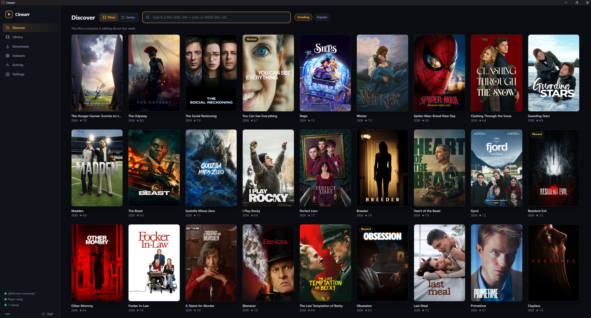
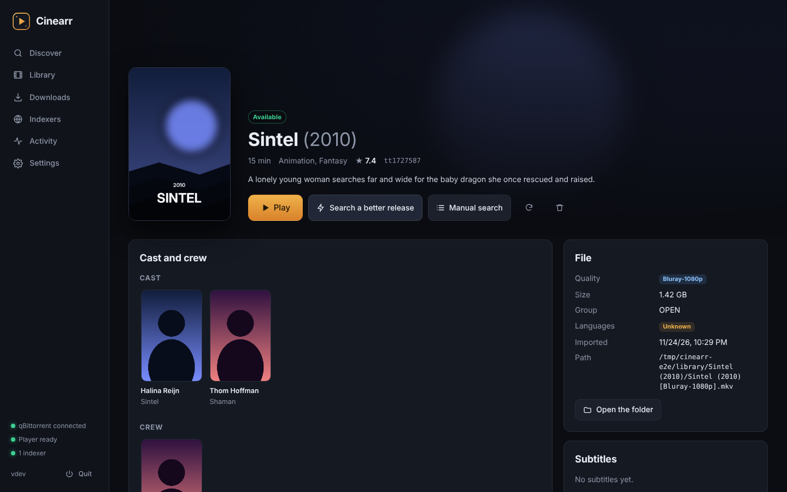
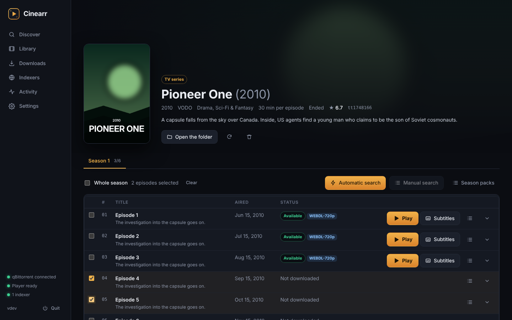
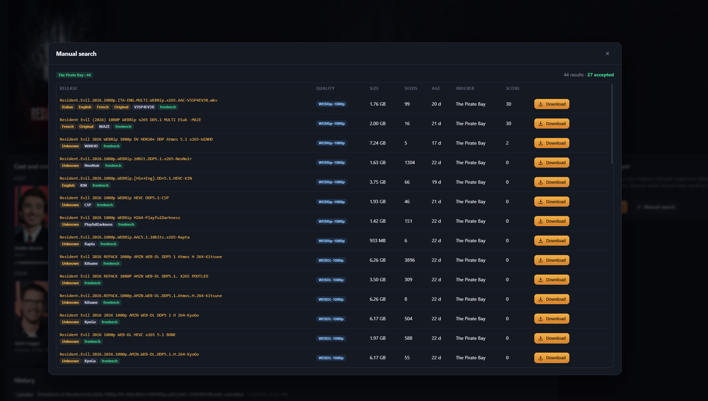
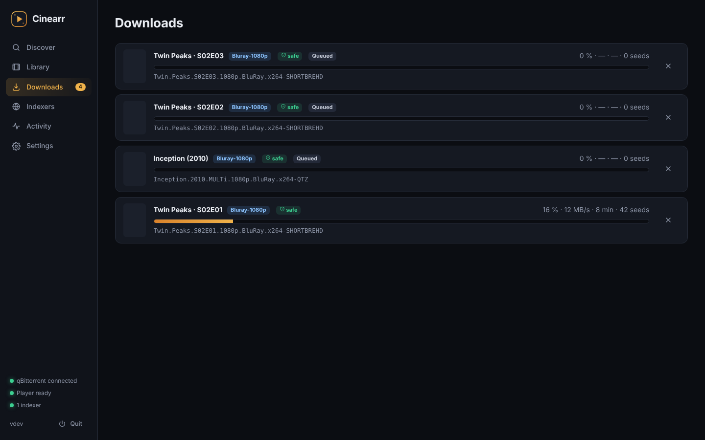

# Cinearr

**Find a film or a series, download it with your torrent client, get its subtitles and watch it, all from one small desktop application.**

Cinearr runs on your own computer: one file of about 10 MB for Windows, macOS and Linux, nothing to install, no server, no account and no telemetry. It works with the torrent client and the video player you already use. The interface is available in English, French, Spanish, Italian and German.

## Features

- **Films and series** from TMDB: add what you want to watch, pick whole seasons or single episodes.
- **Automatic or manual search** on hundreds of public and private torrent sites, or on your own Torznab feeds.
- **Clear decisions**: every release is accepted or refused with a reason (quality, size, language, seeds…), following a quality profile you set.
- **Your torrent client**: qBittorrent, Transmission, Deluge or µTorrent.
- **Safe downloads**: fake releases, executables, shortcuts, scripts and password traps are detected and refused before and after the download.
- **Proxy and VPN support**: searches and `.torrent` downloads can go through an HTTP or SOCKS5 proxy (the one of your VPN), site by site, to reach sites blocked in your country.
- **Tidy library**: films and episodes stored in clean folders, files you add by hand picked up automatically, upgrades to a better quality, a recycle bin for removed files.
- **Subtitles** from many providers or your own sites, downloaded automatically in your languages and saved next to the video.
- **Play** in VLC, MPC-HC or mpv, which Cinearr can also install for you. You can also use your own, after all, these will be video files.

## Screenshots

| | |
|---|---|
|  |  |
|  |  |

## Download

Get the latest version from the [Releases](../../releases) page:

| System | File |
|---|---|
| Windows | `Cinearr-Setup-….exe`: installer with Start Menu shortcut, updater and uninstaller |
| Windows (portable) | `Cinearr-…-windows-x64-portable.zip` (or `arm64`): unzip and run `cinearr.exe` |
| macOS | `Cinearr-…-macos-apple-silicon.dmg` (M1 and later) or `…-macos-intel.dmg`: drag Cinearr to *Applications* |
| Linux | `Cinearr-…-linux-x64.tar.gz` (or `arm64`): extract and run `./install.sh` |

The programs are not signed, so the first launch shows a warning:

- **Windows**: *“Windows protected your PC”*, click *More info › Run anyway*.
- **macOS**: right-click Cinearr › *Open* (or *System Settings › Privacy & Security › Open Anyway*).

Installing, updating and uninstalling are explained in the [user guide](docs/guide.md#install-update-and-uninstall).

## Getting started

You need a free [TMDB](https://www.themoviedb.org/signup) API key, a torrent client with its web interface enabled, and a video player (or let Cinearr install one). At the first launch, a short wizard sets everything up: language, TMDB key, torrent client, folders, player, torrent sites and subtitles.

The **[user guide](docs/guide.md)** explains everything in detail: setup, everyday use, settings, safety and troubleshooting.

## Contributing

Bug reports, ideas, translations and code are welcome. Cinearr is written in Go with the standard library only: `go build ./cmd/cinearr` is all it takes. See [CONTRIBUTING.md](CONTRIBUTING.md). If you work with an AI coding assistant, [AGENTS.md](AGENTS.md) describes the project for it.

## Credits

Cinearr stands on the shoulders of wonderful free software projects. Their authors and contributors did the hard work over many years, and Cinearr reuses a large part of it, ported to Go: thank you to them.

- **[Radarr](https://github.com/Radarr/Radarr)** and **[Sonarr](https://github.com/Sonarr/Sonarr)**: release parsing, qualities, decisions and imports.
- **[Prowlarr](https://github.com/Prowlarr/Prowlarr)**, **[Prowlarr Indexers](https://github.com/Prowlarr/Indexers)** and **[Cardigann](https://github.com/cardigann/cardigann)**: the indexer engine and the site definitions.
- **[Bazarr](https://github.com/morpheus65535/bazarr)** and **[subliminal](https://github.com/Diaoul/subliminal)**: subtitle scores and providers.
- **[VLC](https://www.videolan.org/vlc/)**, **[MPC-HC](https://github.com/clsid2/mpc-hc)** and **[mpv](https://mpv.io)**: the players.
- **[TMDB](https://www.themoviedb.org)**: film and series data. This product uses the TMDB API but is not endorsed or certified by TMDB.

If you run a home server, these projects are the reference and deserve your support. Cinearr is an independent project, not affiliated with them: please report Cinearr issues here, not to them. The detailed list of what comes from where is in [CREDITS.md](CREDITS.md).

The screenshots show open films of the [Blender Foundation](https://studio.blender.org/films/), public-domain classics and the series *Pioneer One*, released under Creative Commons; the posters are placeholders drawn for the demonstration.

## License

Cinearr is free software under the [GNU General Public License v3.0](LICENSE).

## Disclaimer

Cinearr does not host, index or provide any content. Use it only for content you are allowed to download, in compliance with the laws of your country.
