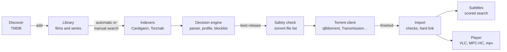

# Cinearr user guide

Everything about Cinearr in detail. For a quick overview, see the [README](../README.md).

- [How it works](#how-it-works)
- [Install, update and uninstall](#install-update-and-uninstall)
- [What you need](#what-you-need)
- [First launch](#first-launch)
- [Everyday use](#everyday-use)
- [Configuration reference](#configuration-reference)
- [Safety](#safety)
- [Troubleshooting](#troubleshooting)

## How it works



1. **Discover**: you search a film or a series on TMDB (title, title + year, or an IMDb link) and add it to your library. Adding downloads nothing.
2. **Search**: from its page you start an *automatic search* (Cinearr picks the best release) or a *manual search* (you see every result and choose). Your indexers are queried in parallel, by IMDb or TVDB id when the site supports it, otherwise by title.
3. **Decision**: every release name is parsed (title, year, season and episodes, quality, languages, group, edition) and checked against your quality profile. Refused releases show why.
4. **Safety**: the `.torrent` file list is inspected *before* the download; for magnet links, as soon as the client knows it.
5. **Download**: the release is sent to your torrent client and followed every few seconds (progress, paused or stalled state, errors, torrents you delete in the client).
6. **Import**: when it is finished, the files are checked again, then hard-linked into your library (the torrent keeps seeding without using twice the disk space), copied or moved.
7. **Subtitles**: the missing languages are searched on your providers and the best one above your score threshold is saved next to the video.
8. **Play**: the *Play* button opens the film or the episode in your player, with your audio and subtitle languages.

## Install, update and uninstall

Your settings and your library are kept in a data folder of your user account, apart from the program: updating or reinstalling Cinearr never loses them.

| System | Data folder |
|---|---|
| Windows | `%APPDATA%\Cinearr` |
| macOS | `~/Library/Application Support/Cinearr` |
| Linux | `~/.config/cinearr` |

### Windows

- **Install**: run `Cinearr-Setup-X.Y.Z.exe`. Choose the folder (by default `%LOCALAPPDATA%\Programs\Cinearr`, no administrator rights needed), and tick *Create a desktop shortcut* if you want one. Cinearr appears in the Start Menu and in *Settings › Apps*.
- **Update**: in *Settings › Data and diagnostics*, **Check for updates** then **Update now**; or run `update.exe` in the installation folder. It downloads the new installer from the releases page, checks it against `checksums.txt`, closes Cinearr, installs the update and starts Cinearr again.
- **Uninstall**: run `uninstall.exe` in the installation folder, or uninstall Cinearr from *Settings › Apps*. You choose between removing the program only, or the program **and** its data folder. Your films, series and downloads are never deleted.
- Running the installer again while Cinearr is installed shows where it is, with buttons to run `update.exe` or `uninstall.exe`.
- **Portable version**: unzip `Cinearr-X.Y.Z-windows-x64-portable.zip` anywhere and run `cinearr.exe`. To keep the data next to the program (on a USB drive, for instance), create a folder named `data` beside it. To update, replace `cinearr.exe` only.

### macOS

Open the `.dmg` and drag **Cinearr** into **Applications**. To update, download the new `.dmg` and replace the application; **Check for updates** in the settings tells you when there is one. To uninstall, move Cinearr to the Trash, and delete its data folder if you no longer need it.

### Linux

Extract the archive and run `./install.sh`: it asks for the folder (by default `~/.local/share/cinearr`), adds Cinearr to the applications menu, creates the `cinearr` command and, if you want, a desktop shortcut. In the installation folder:

- `./update.sh` downloads the latest version, checks it against `checksums.txt` and replaces the program;
- `./uninstall.sh` removes Cinearr, keeping or deleting its data as you choose.

## What you need


- **No key for the film information**: it comes from TMDB (information, posters and IMDb ids), and the official releases include a TMDB key. You can use a key of your own instead (see [Built-in keys](#built-in-keys)).
- **A torrent client with its web interface enabled**:

  | Client | Where | Default address |
  |---|---|---|
  | qBittorrent | *Tools › Options › Web UI* | `http://127.0.0.1:8080` |
  | Transmission | *Edit › Preferences › Remote* | `http://127.0.0.1:9091` |
  | Deluge | *Preferences › Plugins*: enable “WebUi” (password `deluge`) and “Label” | `http://127.0.0.1:8112` |
  | µTorrent | *Options › Preferences › Advanced › Web UI*, with an alternative listening port | `http://127.0.0.1:8080` |

- **Your sites (indexers)**: accounts on the private trackers you use, or nothing for public ones.
- **A video player**: VLC, MPC-HC or mpv. If none is installed, Cinearr can install VLC or MPC-HC for you.

## First launch


A wizard asks, step by step, for:

1. the **language** of the interface;
2. the language of the film pages, and optionally your own **TMDB key** (with a *Check* button);
3. the **torrent client** (with a *Test* button);
4. the **films folder** and the **series folder** (ideally on the same disk as the downloads of the torrent client: imports are then instant hard links);
5. the **video player** (detected, or installed for you);
6. your **indexers** (search the list of sites, enter your credentials, *Test*, *Save*);
7. the **subtitle providers** (optional).

Everything can be changed later in *Settings*.

## Everyday use

### Films

- In **Discover**, search a film and click it to see its summary, then *Add to the library*.
- On the film page: **Automatic search** downloads the best release; **Manual search** lists every release of the film with its quality, size, seeds, indexer and, for refused ones, the reasons. *Download* sends one, *Download anyway* sends a refused one. Results of other films (some sites answer unknown titles with unrelated releases) are left out.
- Your sites are searched by IMDb id **and** by the local, English and original titles, so that a French film is also found under its English title.
- Once downloaded: **Play**, **Search subtitles**, **Open the folder**, or **Search a better release** (upgrades follow your quality profile).
- The film page shows the cast and the crew with their photos.


### Series

- In **Discover**, switch to **Series**, search a series and add it: all its seasons and episodes appear, nothing is downloaded.
- On the series page, choose a season, tick the episodes you want (or **Whole season**) and click **Automatic search**.
  - When every missing episode of a season is ticked, the season is searched first and a **season pack** is taken if one is acceptable; the remaining episodes are then searched one by one.
  - A release containing missing episodes you did not tick is refused, so nothing unwanted is downloaded.
- **Manual search** works on one ticked episode (each row also has its own button); **Season packs** runs a manual search for the whole season.
- Each downloaded episode has **Play** and **Subtitles** buttons. The arrow at the end of a row unfolds the episode: summary, cast and crew with photos, its subtitles, and buttons to search subtitles, open your own subtitle sites or add a subtitle file.
- The first time episodes are downloaded, Cinearr asks where to store the series if no folder was chosen.
- Episodes are stored as `Series/Twin Peaks (1990)/Season 02/Twin Peaks - S02E01 - Episode title [Bluray-1080p].mkv`, and series still on the air are refreshed once a day so that new episodes appear.


### Library and downloads

- **Library** has two tabs, *Films* and *Series*, with filters (available, in progress, wanted, failed, missing episodes, complete).
- **Downloads** lists films and episodes together, with progress, speed, remaining time and state (*Paused*, *Stalled*, *Queued*…). **Cancel** removes the torrent; ticking *Also blocklist this release* prevents it from being downloaded again.
- A torrent you delete directly in your client is noticed after about a minute: the film or the episodes go back to *Wanted*.


### Files added by hand and folder changes

- Cinearr reads the films and series folders **at each launch**, and when you click **Update the library** (*Library*, or *Settings › Library*). Films in a `Title (Year)` folder or directly in the films folder, and series in one folder per series (`Twin Peaks (1990)/…S02E01…`), are identified with TMDB and added to the library with their file; subtitle files next to a video (`Film.fr.srt`) are picked up too. Files that disappeared are detached (the film goes back to *Wanted*), unless their disk is not reachable. Videos that cannot be identified are listed: naming them `Title (Year)` helps.
- The scan skips what is not part of the library: hidden folders, recycle bins (`$RECYCLE.BIN`, `#recycle`, `@Recycle`), system folders (`System Volume Information`, `lost+found`), NAS thumbnails (`@eaDir`, `.@__thumb`), bonus folders inside a film or series folder (`Extras`, `Featurettes`, `Trailers`, `Behind The Scenes`…), bonus videos named the Plex way (`Film-trailer.mkv`) and samples.
- What makes a film part of the library is its entry in `library.json` (series: `series.json`), created when you add it or when the scan finds it; the entry keeps the path of its file once there is one.
- When you change the films or series folder in the settings, the paths stored in the library are rewritten to the new folder. Files are not moved: move them yourself, the next update finds them.
- Subtitles are always saved next to the video, in the folder of the film or of the season.
- If `library.json` or `series.json` cannot be read (damaged disk, file cut, edited by hand), Cinearr starts anyway: the damaged file is kept aside as `library.json.unreadable-<date>`, the entries still readable are kept, and the scan of the launch rebuilds the rest from the films and series folders. Films that were only *Wanted* (no file yet) can only come back from the readable part. The history shows what happened.
- **Folder checks**: Cinearr refuses as films or series folder the root of the system disk, a system folder (`C:\Windows`, `Program Files`, `/usr`…), your home folder itself, its own data or program folder, the same folder for films and series (or one inside the other), and a folder that contains the download folder of the torrent client (the scan would read unfinished downloads).
- **Recycle bin**: files removed from the library or replaced by a better release go to the hidden folder `.cinearr-recycle` at the root of the films or series folder (one subfolder per day) and are erased after 7 days (*Settings › Library › Recycle bin*; 0 deletes at once). To get a file back, move it to its place and click **Update the library**.
- Without an internet connection, the library, the files and playback keep working; posters, cast photos, Discover, searches and subtitles need the network.

### Activity

- **History**: every addition, grab, import, failure, subtitle and playback.
- **Blocklist**: the releases that will never be downloaded again (dangerous content, failure, or your choice), with a button to remove an entry.
- **Log**: the live log, with an *Errors only* filter.

### Starting again from scratch

*Settings › Data and diagnostics › Reset Cinearr* erases every setting (TMDB key, torrent client, folders, indexers, subtitle providers, player, language), the history and the blocklist, then starts the wizard again. Your films and series stay in the library and **no file is ever deleted**. Two options also empty the library lists or delete the players Cinearr installed.

## Configuration reference

Settings are grouped in tabs: *General*, *Torrent client*, *Library*, *Quality*, *Subtitles*, *Player*, *Data and diagnostics*.

### Languages

*Settings › General* has two languages: the one of the interface and the one of the film and series pages (titles, summaries, episode names, from TMDB). When you change the language of the interface, the pages follow it if they were in the same language. When the language of the pages changes, every film and series of your library is reloaded in the background in the new language, with no restart; the *Library* page shows the progress.

### Proxy (VPN)

Some torrent sites are blocked in some countries (in France, by the DNS of the internet providers). *Settings › General › Proxy (VPN)* sends Cinearr's requests through an HTTP or SOCKS5 proxy. Most VPN services provide one (address, port, user name and password in their member area).

- **What goes through it**: the searches on the indexers and the `.torrent` downloads; optionally TMDB and the subtitle providers too. Local addresses (the torrent client, Jackett or Prowlarr on your network, `localhost`, `192.168.…`, names without a dot) are always reached directly.
- **Site names are resolved by the proxy**, so a site hidden by the DNS of your provider is reached.
- **One site at a time**: an indexer can be excluded in its settings (*Connect directly, without the proxy*), for private trackers that refuse VPN addresses.
- **Test the proxy** shows the address and the country the sites see, compared with your own.
- The proxy only concerns Cinearr. **The downloads themselves are made by your torrent client**: to protect them, set the VPN (or its proxy) in the client, for instance qBittorrent's *Options › Connection › Proxy* or its network interface binding. If a VPN application already protects the whole computer, nothing has to be set in Cinearr.

### Failing sites

A site that fails several times in a row (down, blocked, quota reached) is paused for the automatic searches: 1 minute after the first failure, then 5, 15, 30 minutes, 1, 3, 6, 12 and at most 24 hours. Searches you start yourself still try it, and a success (or **Test**) ends the pause. The *Indexers* page and *Settings › Subtitles* show the paused sources with a **Resume** button.

### Quality

The quality profile lists the allowed qualities from worst to best, a target quality (no upgrade beyond it), preferred and required languages, what a “MULTi” release contains, minimum seeds, maximum size, required and forbidden terms (plain text or `/regex/`), preferred terms with points, refusal of hardcoded subtitles and an anti-fake size check. Ready-made profiles (*HD-1080p*, *Ultra-HD*…) can be applied in one click.

### Subtitles

You add the providers you want and enter their account or key when they need one. Each has a **Test** button.

| Provider | Needs | Languages | Films | Series |
|---|---|---|---|---|
| OpenSubtitles.com | A free account (optional, raises the daily quota); an API key only if you build Cinearr yourself | All | Yes | Yes |
| SubDL | A free API key | Many | Yes | Yes |
| Addic7ed (Gestdown) | Nothing | Many | No | Yes |
| TVsubtitles.net | Nothing | Many | No | Yes |
| BetaSeries | A free API key ([betaseries.com/api](https://www.betaseries.com/api/)) | French, original | No | Yes |
| Subsource | A free API key | Many | Yes | No |
| YIFY Subtitles | Nothing | Many | Yes | No |
| Subsynchro | Nothing | French | Yes | No |
| Other service | The address of any service exposing the OpenSubtitles.com API (and its key) | — | Yes | Yes |
| Your own site | The address of its search page, with `{query}` where the title goes | — | Yes | Yes |

Nothing restricts you to this list:

- **Other service (OpenSubtitles-compatible API)** is searched automatically like the providers above: a self-hosted aggregator, a mirror, a new service using the same API.
- **Your own site** works with any subtitle website: in the subtitle search of a film or an episode, a *Search on …* button opens its search page with the title filled in (`{query}`, `{title}`, `{original}`, `{year}`, `{imdb}`, `{tmdb}`, `{season}`, `{episode}`, `{s00e00}` and `{lang}` are replaced). You download the subtitle there and add it with **Add a subtitle file**.
- **Add a subtitle file** accepts `.srt`, `.ass`, `.ssa`, `.vtt`, `.sub` or a `.zip`: the file is saved next to the video, converted to UTF-8, and the player loads it.

The official releases include an OpenSubtitles.com application key: you only enter your OpenSubtitles account. Without an account, OpenSubtitles allows 5 downloads a day; with a free account, 20.

### Built-in keys

The official releases include a TMDB key and an OpenSubtitles.com key, so you can start without creating any. The limits of both services apply to each user separately (per address and per account), not to the key: other Cinearr users do not use up your share.

If one of these services stops accepting the key provided with Cinearr (it can be revoked or blocked), Cinearr tells you in a window, in the side bar and in the settings. You can then enter a key of your own, free, which Cinearr uses instead:

- **TMDB**: create an account on [themoviedb.org](https://www.themoviedb.org/signup), then *Settings › API* and request a “Developer” key (personal use); copy the “API Key” or the “API Read Access Token” into *Settings › General › TMDB key*.
- **OpenSubtitles.com**: on [opensubtitles.com](https://www.opensubtitles.com/en/consumers), *avatar › API consumers › New consumer*; copy the API key into *Settings › Subtitles*, in the OpenSubtitles.com provider.

A key you entered is always used before the built-in one. If you build Cinearr yourself, it has no built-in key unless you give one (see `CONTRIBUTING.md`).


### Players

| Player | Systems | Automatic installation |
|---|---|---|
| VLC | Windows, macOS, Linux | Windows and macOS: portable version from download.videolan.org, checksum verified |
| MPC-HC | Windows | Portable version from GitHub (clsid2/mpc-hc), checksum verified |
| mpv | Windows, macOS, Linux | No: `winget install shinchiro.mpv`, `brew install --cask mpv` or your package manager |
| Other | — | Any program that takes the path of the video as argument |

Players installed by Cinearr live in its data folder, in portable mode: they change neither the registry nor an existing installation.

### Data folder

The folder is listed in [Install, update and uninstall](#install-update-and-uninstall). It holds `settings.json`, `library.json`, `series.json`, `history.json`, `blocklist.json`, the indexer definitions cache, the installed players and the log. **Portable mode**: create a folder named `data` next to the executable and everything is stored there.

### Command line

```
cinearr [-data FOLDER] [-browser] [-no-window] [-debug] [-listen ADDRESS:PORT]
```

| Option | Effect |
|---|---|
| `-data` | Use another data folder |
| `-browser` | Open the interface in the default browser instead of an application window |
| `-no-window` | Server mode, without window (NAS, home server) |
| `-debug` | Detailed log from the start |
| `-listen ADDRESS:PORT` | Advanced: listen on another address. Cinearr is made for use on your own computer and has no login, so never expose it beyond a network you fully trust |

Closing the window stops Cinearr; downloads continue in the torrent client and are imported at the next launch.

## Safety

Torrent sites are a common way to spread malware (fake films as `.exe`, `.lnk` shortcuts, password-protected archives). Cinearr applies several barriers:

- **Before the download**: the `.torrent` file list is decoded and inspected. Executables (`.exe`, `.bat`, `.cmd`, `.sh`…), dangerous files (`.lnk`, `.scr`, `.vbs`, `.ps1`, `.msi`, `.js`…), misleading double extensions (`film.mkv.exe`), the absence of video or a tiny main video refuse the release and blocklist it.
- **Magnet links**: the same check runs as soon as the client receives the metadata; a dangerous torrent is deleted with its files.
- **At import**: the downloaded files are inspected a second time.
- **Your own rules**: *Settings › Library › Import checks* adds file extensions to refuse in the downloads of films and series (for instance `.url`, `.iso`, `.wmv`), and sets the free space to keep on the library disk (100 MB by default, checked when choosing a release and before every copy).
- **Subtitles**: every subtitle is checked before it is saved: a web page (captcha, login), an empty file or a file without any timed line is refused, and the extension follows the real format. The language code given by a provider is checked too, so a subtitle is always written in the folder of its video.
- **Player installation**: VLC and MPC-HC are installed only when their published SHA-256 checksum matches; without a published checksum, the installation stops.
- **Links from the sites**: only `http` and `https` links of indexers and providers are shown.
- **Anti-fake**: a “1080p” release of 300 MB for a two-hour film is refused; suspicious names (executable, codec pack, keygen, password) too.
- **Local application**: the interface only listens on `127.0.0.1`, checks the host, requires a custom header against cross-site requests and applies a strict content security policy.

Cinearr never runs a downloaded file; only the video is opened, in your player.

## Troubleshooting

- Every failed action shows a notification with its cause, and the sidebar shows the state of the torrent client, the player and the indexers (hover for the exact error).
- **Activity › Log** shows the live log; enable **Detailed log** (*Settings › Data and diagnostics*, or `-debug`) to record every request to the sites, TMDB, the torrent client and the subtitle providers.
- **Export a diagnostic** creates a zip with the log, the crashes, the version, the system, the settings, the library and the history. Every log line is cleaned before it is written: passwords, keys, tokens, cookies, credentials in URLs, tracker passkeys, e-mail addresses and the user name in home folder paths (`C:\Users\***\…`, `/home/***/…`) are hidden, so it can be attached to an issue as is.
- After a crash, the trace is in `crash.log` and the next launch reports it.

### Current limits

- Series: standard numbering only (S01E05). Anime absolute numbering and daily shows (episodes named by date) are not supported.
- No RSS monitoring: films and episodes are searched when you ask (and again after a failed download), not as soon as a new release appears.
- BitTorrent only (no Usenet). Sites protected by Cloudflare challenges (FlareSolverr) and logins with a captcha are not supported; use the “cookie” login when the definition offers it.
- `.rar` releases are not extracted: they are refused.
